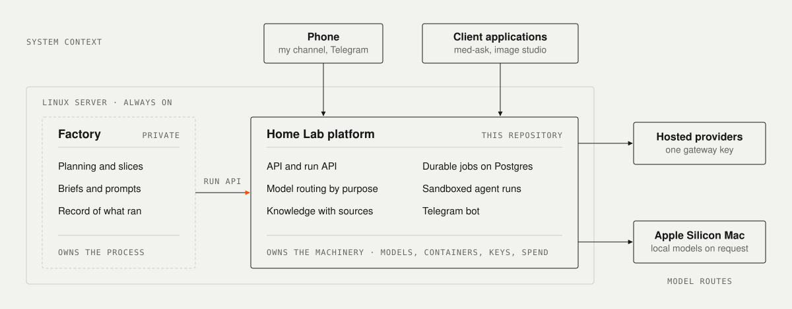

# Home Lab

A self-hosted applied-AI platform providing shared model access, retrieval and secure execution
for independent applications, with an AI-assisted development system that builds and maintains
those applications and the platform itself.

> [!NOTE]
> **Operational, under active development.** The platform, Factory and several applications run
> every day on a self-hosted server; the eval and the items under [*Where it is going*](#where-it-is-going)
> are still being built.

## Why it exists

My projects need models, search over my own knowledge, and work that runs in the background.
Without a shared base, each project repeats the same keys, routing and job code. I also want to
learn applied AI engineering by building systems that I use every day.

Home Lab provides the infrastructure for model routing, APIs and secure execution. Built on top
of it, [Factory](https://github.com/TelesforoAleix/factory) orchestrates AI-assisted software
development. It separates planning and orchestration from sandboxed agent execution, automated
review and deployment.

## The system

I designed Home Lab and I operate it. It runs on a small Linux server (a Lenovo M700). An Apple
Silicon Mac is a worker for local models. From my laptop and my phone, I reach Workshop,
Factory's private web console, over a private network. The phone also has a Telegram bot for
alerts and notices. Applications ask for a *purpose*, such as chat, embed or vision, and never
for a model.

<picture>
  <source media="(prefers-color-scheme: dark)" srcset="docs/diagrams/system-dark.svg">
  
</picture>

**Home Lab is the execution platform; Factory is the development orchestrator.**

- **Factory owns the process:** planning, cutting work into slices, prompts, and the record of
  what ran.
- **The platform owns the machinery:** models, containers, execution, routing, keys and spend.
- **Each side works without the other.**
- **Workshop** is Factory's private web console: a pipeline board, planner chats, an inbox of
  ideas, and pages for runs, costs and settings. I use it from my laptop and my phone.

## How one piece of work flows

This flow runs today.

<picture>
  <source media="(prefers-color-scheme: dark)" srcset="docs/diagrams/work-flow-dark.svg">
  
</picture>

The deployer installs Factory and applications; this platform is still deployed by hand.

## What I designed and decided

I own the system architecture, the technical decisions, the execution boundaries and the
acceptance criteria. AI coding agents implement the changes. I validate them through reviews,
tests and operational feedback.

- **Purposes, not model names.** LiteLLM is the single route table. Applications ask for a
  purpose (chat, embed, grade, vision). Only the LiteLLM container holds the gateway key.
- **Mature libraries own the machinery.** LiteLLM routes, LlamaIndex retrieves, Procrastinate
  runs jobs, python-telegram-bot runs the bot. Version 1 used only the standard library, and
  that constraint was its main cost.
- **Process and machinery are separate.** Factory decides what to build and records it. The
  platform runs it, and holds the keys and the spend limits.
- **Containment.** Agents run in sandbox containers. A fixed launcher starts every container, and
  the `runs` service has no Docker socket. The launcher and the deployer are the only root helpers.
- **Risk-based autonomy.** Changes fall into four risk levels, from fully automatic to mandatory
  human approval. Secrets, destructive operations, money limits and new public exposure need my
  approval. See [`.github/change-classes`](.github/change-classes).
- **Executors are data.** [`config/executors.yaml`](config/executors.yaml) lists the executors for
  each level in order: Codex first, Claude when usage limits require it. Small tickets can run on
  the open-source Pi agent with a low-cost hosted model.

## What the platform does

| Part | What runs today |
|---|---|
| Model routing | Applications ask for a purpose: chat, embed, vision, grade and others. A LiteLLM route table sends each request to a hosted provider through one gateway key (Vercel AI Gateway), or to a local model. Embeddings for questions run on the server. Bulk embedding and vision can run on the Mac, through a llama.cpp router that starts a model on request and stops it when idle. The Mac publishes what it can serve and the server polls it, so the Mac can be away. |
| Mac profiles | Two usage profiles, Working and Inference, with a menu-bar app. A queue runs long GPU jobs one at a time. |
| Knowledge | Ingestion with sources (LlamaIndex), Postgres with pgvector, and answers that cite their sources. |
| Durable jobs | Procrastinate on Postgres. A job is stored before it is acknowledged. |
| Agent runs | The run API (`POST /v1/runs`) takes tickets, whole slices, cuts, reviews and eval runs. The run API uses application-scoped keys. Agent configurations are data folders with a hash, and every run records what ran. |
| Typed decisions | [`POST /v1/decisions`](docs/decisions-api.md) makes named choices with probabilities, confidence and agreement across repeats, through a scoped run key and a separate monthly cap. |
| Images and video | Image and video generation purposes for the image studio, with one monthly budget on the gateway key and alerts at 80% and 100%. |
| Security | Encrypted volumes (LUKS), SSH keys only, a private admin network, non-root service containers. A fixed launcher and a deployer are the only root helpers. A private-content check runs before any push to a public repository. CI scans for secrets. |
| Operations | Daily database dumps with a restore check, weekly encrypted copies, and failure alerts to my phone. |
| Clients | [med-ask](https://github.com/TelesforoAleix/med-ask) (search over medical textbooks, with sources), the image studio, and the Telegram bot. |

The full reference is in [docs/platform.md](docs/platform.md).

## Where it is going

**Now, being built**

- An eval that compares models and agent configurations on quality, speed and cost. Its case
  sets come from my own past work. Pages show eval results and run traces.
- Every agent run goes through the platform's run API, and the old runner retires.

**Next**

- Smaller models where they are enough. The eval shows which work a low-cost or local model can
  take. Each task goes to the smallest model that does it reliably, and slices are cut into
  smaller tasks for these models.
- The Mac as a local worker: local models take light work first, and hosted models are the
  fallback.
- Management from Workshop: providers, keys per application, access and spending limits.
- Safer operations: platform services as versioned images with automatic installs, and a
  restore that I rehearse.
- Local decision models behind the typed decisions contract, for classification and narrow choices.

**Later, when a project needs it**

- Tools for agents: knowledge as an MCP server, a web-research MCP server, and a tool gate that
  the platform controls.
- Agent workflows that can pause and resume (LangGraph), structured output and streaming.
- Voice: speech-to-text behind a purpose, and voice notes through Telegram.

A project's need sets the order first, then measurement. I design and stress-test each item
before agents build it in small slices.

## For agents and operators

- [AGENTS.md](AGENTS.md): how to work in this repository.
- [ARCHITECTURE.md](ARCHITECTURE.md): boundaries, routes and the eight rules.
- [DECISIONS.md](DECISIONS.md): the choices behind them.
- [docs/platform.md](docs/platform.md): reference for what runs today.
- [docs/operations.md](docs/operations.md): operator runbook for the stack, Mac services, node
  rebuilds and originals copies.
- [docs/run-api.md](docs/run-api.md) and [docs/deployer.md](docs/deployer.md): the run API and
  the application deployer.

### Quick start

```bash
# Development (no services)
uv sync
uv run pytest
```

Running the stack needs a provisioned node; see the [operator runbook](docs/operations.md#run-it).

### Project structure

| Path | What |
|---|---|
| `src/homelab/api/` | FastAPI API |
| `src/homelab/models/` | Purpose discovery and model clients |
| `src/homelab/knowledge/` | LlamaIndex ingestion and retrieval |
| `src/homelab/jobs/` | Procrastinate tasks and worker |
| `src/homelab/tasks/` | Run/task records and the submit, claim and finish commands |
| `src/homelab/runs/` | Container task runner started with the platform and launcher client |
| `config/litellm.yaml` | Model purposes and routes |
| `node/` | Host files at their installed paths (table entries are merged) |
| `mac/` | Usage profiles, measurements, model router and action listener |

First version: [homelab-v1](https://github.com/TelesforoAleix/homelab-v1)
