# Home Lab v2

My personal AI system: model access, knowledge retrieval with sources, and durable background jobs.

> [!WARNING]
> **In development.** Model access, knowledge retrieval with cited answers and durable jobs run on the node today; applications such as med-ask build on it.

## Overview

Every side project needed model access without keys scattered across repositories, search over
my own knowledge with answers that show their sources, and work that keeps running in the background.
HomeLab builds these once on a small always-on server that my projects plug into.
This second version keeps the lessons from the learning-first v1 and leans on mature tools.

## Architecture

<picture><source media="(prefers-color-scheme: dark)" srcset="docs/diagrams/architecture-dark.svg"></picture>

Solid parts are built; dashed parts are planned.

- The diagram shows where HomeLab is heading: one API for every client. Today med-ask reaches
  only LiteLLM, over the `homelab-models` network.
- `embed-large` stays on the node for questions; `embed-large-bulk` uses the same vector space
  on the owner’s Mac through a login-managed llama.cpp router for bulk ingest. See the
  [Mac serving runbook](docs/operations.md#mac-bulk-embedding-serving).
- Mac login agents run a stamped, private [installed copy from main](docs/operations.md#install-and-update-the-mac-tools),
  independent of the working checkout. Update with `git pull --ff-only` and `mac/install-mac-tools`.
- The [Mac profile command](docs/operations.md#mac-usage-profiles) selects Working or Inference,
  reports observed state as JSON, and returns to Working after idle inference. Each profile
  sets services to off, on request, or on, with allowed models and a default from a private
  registry. It can download, verify and test-load new models and reports warning-only
  profile memory budgets that include mapped weights; see [profile model policy](docs/operations.md#per-profile-service-and-model-policy). After 10
  continuous minutes on battery, Inference pauses its model services and resumes on AC.
  Working leaves the owner’s AC and Battery settings alone. Inference requires AC power,
  changes only AC power mode/sleep and the global GPU limit, and restores their recorded
  values on return. Relaunched apps
  restore windows and tabs according to their own settings: Chrome’s “Continue where you left
  off” and macOS’s “Close windows when quitting an application” are owner choices.
- A SwiftUI [menu bar app](docs/operations.md#menu-bar-app-usage-and-night-window) drives the
  same command: one-click switching, per-service control, a Profiles editor for service states,
  allowed/default models and warning-only memory budgets, requests waiting for Inference,
  Claude/Codex usage, and an owner-set night window into Inference that is off by default.
- Knowledge endpoints: `POST /v1/knowledge/query` and `/v1/knowledge/answer`; jobs persist in Postgres.
- Hosted images use three `image-*` purposes through LiteLLM, with capability profiles at
  `GET /v1/model/info`, reference edits and a separate $20 monthly gateway-key budget.
- [ARCHITECTURE.md](ARCHITECTURE.md) explains the boundaries and rules;
  [DECISIONS.md](DECISIONS.md) records the choices behind them.

The Telegram bot runs as a sandboxed host service using python-telegram-bot in its own
hash-pinned virtual environment. It long-polls Telegram and remains available
before the data volumes are unlocked. After unlock, an optional read-only planning mirror
supplies `/pending`, `/recap [hours]`, `/slice <id>` and notices for new outbox events.
Allowlisted free-text questions use the `frontline` purpose through LiteLLM on
`127.0.0.1:4000`, grounded in privately configured planning files and pending work.
In-memory episodes keep follow-ups together; replying to an older answer reopens its episode.
The model can read one extra bounded clone file and propose one order; it cannot execute.
The bot validates proposals and shows Yes/No buttons. Only an allowlisted tap queues an order
on the encrypted volume. A [tailnet-only HTTP endpoint on TCP 8110](docs/operations.md#bot-order-endpoint)
hands queued orders to a future Mac runner; Tailscale policy gates it, with no key.
The inbox keeps ideas, links, unprocessed attachments and messages for repository orchestrators.
The model classifies free text and asks at most two short clarifying questions; “just save it”
keeps what is known. `/inbox [id]` lists or shows kept items. Public links have a guarded
fetch and isolated summary; files are limited to 20 MiB each and 2 GiB in total.
The inbox lives beside orders on the encrypted volume. Mac orchestrators use the root-owned
[`homelab-inbox` helper over SSH](docs/operations.md#inbox-helper-over-ssh) to list new items,
stream attachments and mark records read; it adds no network route.
Answers and new proposals require unlock and the model gateway; host commands remain available while locked.
Private configuration and a read-only deploy key stay on the node; see the
[bot runbook](docs/operations.md#run-it).

Docker state and rebuildable files live on the encrypted second SSD at `/srv/homelab-bulk`;
databases, originals and corpus stay on `/srv/homelab`. After boot the owner unlocks main,
which supplies bulk’s key, then Docker and the applications start. See
[Rebuilding the node](docs/operations.md#rebuilding-the-node) for setup and recovery.

## Quick start

```bash
# Development (no services)
uv sync
uv run pytest
```

Running the stack needs a provisioned node; see the [operator runbook](docs/operations.md#run-it).

## Project structure

| Path | What |
|---|---|
| `src/homelab/api/` | FastAPI API |
| `src/homelab/models/` | Purpose discovery and model clients |
| `src/homelab/knowledge/` | LlamaIndex ingestion and retrieval |
| `src/homelab/jobs/` | Procrastinate tasks and worker |
| `config/litellm.yaml` | Model purposes and routes |
| `node/` | Host files at their installed paths (table entries are merged) |
| `mac/` | Usage profiles, measurements, model router and action listener |

First version: [homelab-v1](https://github.com/TelesforoAleix/homelab-v1)

Used by: [med-ask](https://github.com/TelesforoAleix/med-ask)

[Operator runbook](docs/operations.md): running the stack, Mac services, node rebuilds and originals copies.

## Mac job queue

The installed `homelab-profile` runs resumable commands one at a time through launchd, in
any profile. Commands use an absolute executable and argv, without a shell:

```bash
homelab-profile queue add corpus --cwd /absolute/project -- /absolute/python /absolute/label.py
homelab-profile queue list
homelab-profile queue play
homelab-profile queue stop
homelab-profile queue top corpus
homelab-profile queue remove corpus
homelab-profile queue requeue corpus
```

Every command prints JSON; `status` includes the same queue data. `top` moves a waiting job
forward without interrupting a run. `stop` terminates the whole process group (SIGKILL after
10 seconds), turns play off and puts that job first, waiting. `play` resumes from whatever the
command saved. A nonzero exit retries once, then stays failed while the queue moves on;
`requeue` resets a failed or stopped job's attempts and appends it. Remove waiting, failed or finished
jobs to delete their local logs and progress files.

Nothing starts on battery. Ten continuous minutes on battery stop the running job while
keeping play on (`paused_on_battery`); ten continuous minutes back on AC resume it. A running
job keeps the Mac awake, but closing the lid still sleeps it. Scheduled jobs retain their
profile/AC/idle requirements and take the next slot before queued work. Queue jobs count as
activity for the automatic return to Working, without changing profiles themselves.

Logs (0600) stay under `~/.local/state/homelab-profile/` until removal. A command may overwrite
the file named by `HOMELAB_QUEUE_PROGRESS` with one short progress line. Status reports that
line, elapsed seconds, attempt, log path, process-group physical footprint (`physical_footprint_mb`)
and available memory (`free_memory_mb`) in MiB. Footprint includes charged Metal allocations
but excludes clean mapped model-file pages; available memory uses macOS `memory_pressure`'s
free percentage (including immediately reclaimable memory), rounded by macOS to whole percent.
Install updates from merged main using `mac/install-mac-tools`; the queue worker is the
`org.homelab.profile.queue` login agent.

The menu’s **Job queue** section sits below services: Play/Stop, battery pause, running job,
elapsed time, attempt, progress and footprint beside available memory. Waiting jobs stay in
order with **To front** and **Remove**; failed jobs offer **Requeue** and **Remove**, finished
jobs **Remove**. Moving to front leaves the running job alone; Stop immediately stops the
attempt, so unsaved items are redone on resume. Status refreshes every five seconds while the
menu is open. Add jobs through the command above.
