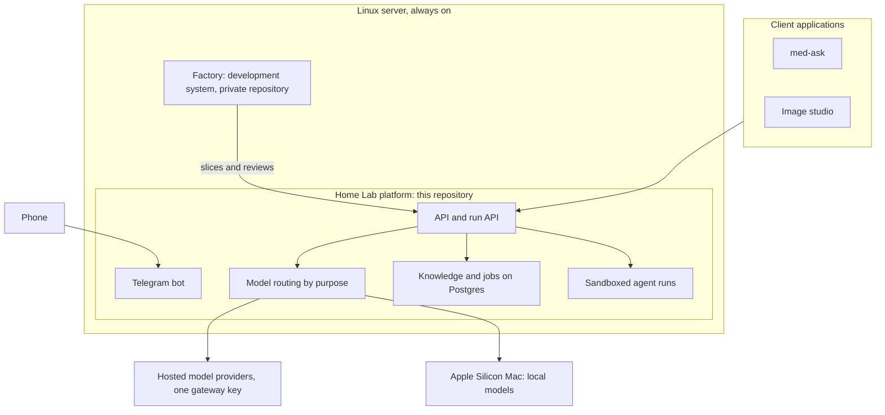
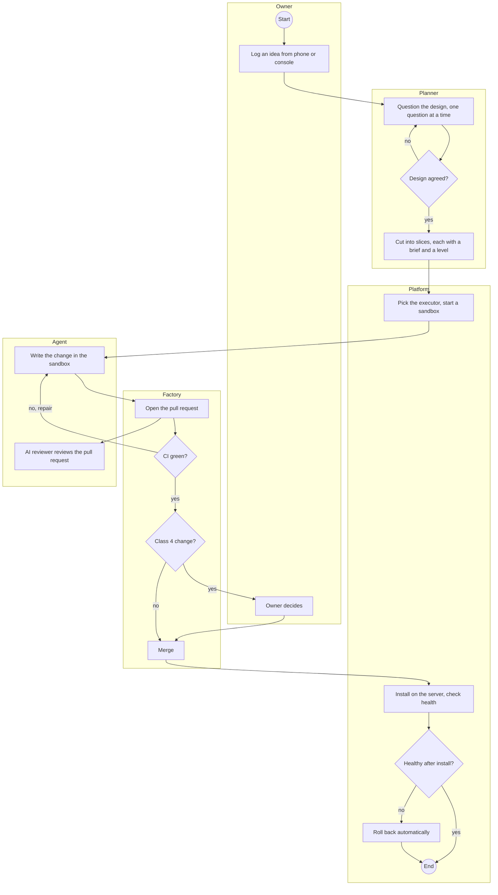

# Home Lab

A self-hosted applied-AI platform, and the base for an AI development system that builds it.

> [!NOTE]
> **In development, running daily.** The platform runs 24/7 on a small server, and applications
> such as [med-ask](https://github.com/TelesforoAleix/med-ask) build on it.

## Why it exists

The owner's projects need models, search over their own knowledge, and work that runs in the
background. Home Lab builds these once, on one small server, so each project does not repeat them.
It is also a way to learn applied AI engineering by building systems that are used every day.
A second system, Factory, uses AI agents to build this platform and its client applications.

## The system

The owner designed and operates Home Lab. It runs on a small Linux server (a Lenovo M700). An
Apple Silicon Mac is a worker for local models. A phone is the owner's channel to the system,
through a Telegram bot. Applications ask for a *purpose*, such as chat, embed or vision, and
never for a model.



Factory and the platform are separate. **Factory owns the process**: planning, cutting work into
slices, prompts, and the record of what ran. **The platform owns the machinery**: models,
containers, execution, routing, keys and spend. Each side must work without the other. Factory is
private for now. It has a private web console (Workshop) with a pipeline board, planner chats, an inbox of
ideas, and pages for runs and costs.

## How one piece of work flows

This flow runs today.



1. The owner logs an idea, from the phone or the console.
2. A planner (a Claude session) questions the design with the owner, one question at a time,
   until the design is agreed.
3. The planner cuts the feature into **slices**. A slice is one agent session, one branch, one
   pull request and one done-criterion. Each slice gets a self-contained brief and a level of
   work: light, standard or strong.
4. Factory sends the slice to the platform's run API. The platform picks the executor for the
   level from a data file, [`config/executors.yaml`](config/executors.yaml): Codex first, Claude
   when usage limits require it. Small tickets can run on the open-source Pi agent with a low-cost
   hosted model.
5. The agent works in a sandbox container. It has one copy of the repository, network access
   only to its model provider, GitHub and package registries, and no server secrets. A fixed
   root launcher starts every container. The `runs` service has no Docker socket.
6. Factory opens the pull request and CI runs. At the same time, an AI reviewer (Claude) reviews
   the pull request. Its verdict is recorded beside the planner's own review.
7. When CI is green, Factory merges. A deployer installs the commit on the server and checks
   health. If the install is unhealthy, the deployer rolls back by itself.
8. There are four classes of change: (1) automatic; (2) automatic with stronger checks, such as
   a database dump before a migration; (3) proceed and notify; (4) the owner decides. Class 4
   covers guard files, secret values, deleting data that cannot be replaced, money limits, a new
   public endpoint, and making a repository public. Guard files need the owner's code-owner
   review on GitHub.

**Two levels of work.** A private planning repository holds direction, decisions, designs, the
backlog and briefs. Project repositories, such as this one, hold only what exists and works.
Only a self-contained brief crosses from planning to a project, and a project never refers back
to the planning side.

## What the platform does

| Part | What runs today |
|---|---|
| Model routing | Applications ask for a purpose: chat, embed, vision, grade and others. A LiteLLM route table sends each request to a hosted provider through one gateway key (Vercel AI Gateway), or to a local model. Embeddings for questions run on the server. Bulk embedding and vision can run on the Mac, through a llama.cpp router that starts a model on request and stops it when idle. The Mac publishes what it can serve and the server polls it, so the Mac can be away. |
| Mac profiles | Two usage profiles, Working and Inference, with a menu-bar app. A queue runs long GPU jobs one at a time. |
| Knowledge | Ingestion with sources (LlamaIndex), Postgres with pgvector, and answers that cite their sources. |
| Durable jobs | Procrastinate on Postgres. A job is stored before it is acknowledged. |
| Agent runs | The run API (`POST /v1/runs`) takes tickets, whole slices, cuts, reviews and eval runs. Each application has its own keys and scopes. Agent configurations are data folders with a hash, and every run records what ran. |
| Images and video | Image and video generation purposes for the image studio, with a monthly cost limit and alerts. |
| Security | Encrypted volumes (LUKS), SSH keys only, a private admin network, non-root service containers. A fixed launcher and a deployer are the only root helpers. A private-content check runs before any push to a public repository. CI scans for secrets. |
| Operations | Daily database dumps with a restore check, weekly encrypted copies, and failure alerts to the owner's phone. |
| Clients | [med-ask](https://github.com/TelesforoAleix/med-ask) (search over medical textbooks, with sources), the image studio, and the Telegram bot. |

The full reference is in [docs/platform.md](docs/platform.md).

## Evidence

- About 360 slices delivered this way since 2026-09-19, across the platform, Factory and the
  client applications.
- First ticket batch on a low-cost hosted model: 13 of 13 tickets done, for $0.43 in total.
- A real slice cut into 4 tickets: done in about 4 minutes, for about $0.03.
- 93.5% of input tokens for ticket runs came from the prompt cache on the hosted route.
- Retrieval eval of the first knowledge client: hit@5 100% and MRR 0.978 on
  69 questions (2026-10-02).
- About 2,600 tests in this repository.

## What I am exploring

> How far can AI agents take software development on their own (safely, cheaply and in a way I
> can measure), and where does a human still add the most value?

1. **Capability where it pays.** Which work needs a frontier model, and which can a small or
   local model do as well? I measure models on my own past work, not on public benchmarks.
2. **Autonomy that is safe by design.** How much can agents plan, merge and deploy alone? Human
   approval is sized to what a mistake would cost.
3. **Context, not prompts.** How does a system prepare what an agent needs to know, so each agent
   starts small and focused? Strategy stays apart from execution, and work is handed over as a
   self-contained brief.
4. **The human's new role.** When agents write the code, I work as architect, decision maker and
   reviewer.

**Next:** an eval that compares models and agent configurations on quality, speed and cost. Its
case sets come from this project's own history.

## For agents and operators

- [AGENTS.md](AGENTS.md): how to work in this repository.
- [ARCHITECTURE.md](ARCHITECTURE.md): boundaries, routes and the eight rules.
- [DECISIONS.md](DECISIONS.md): the choices behind them.
- [docs/platform.md](docs/platform.md): reference for what runs today.
- [docs/operations.md](docs/operations.md): operator runbook for the stack, Mac services, node
  rebuilds and originals copies.
- [docs/run-api.md](docs/run-api.md) and [docs/deployer.md](docs/deployer.md): the run API and
  the application deployer.

### Quick start

```bash
# Development (no services)
uv sync
uv run pytest
```

Running the stack needs a provisioned node; see the [operator runbook](docs/operations.md#run-it).

### Project structure

| Path | What |
|---|---|
| `src/homelab/api/` | FastAPI API |
| `src/homelab/models/` | Purpose discovery and model clients |
| `src/homelab/knowledge/` | LlamaIndex ingestion and retrieval |
| `src/homelab/jobs/` | Procrastinate tasks and worker |
| `src/homelab/tasks/` | Run/task records and the submit, claim and finish commands |
| `src/homelab/runs/` | Container task runner started with the platform and launcher client |
| `config/litellm.yaml` | Model purposes and routes |
| `node/` | Host files at their installed paths (table entries are merged) |
| `mac/` | Usage profiles, measurements, model router and action listener |

First version: [homelab-v1](https://github.com/TelesforoAleix/homelab-v1)

Used by: [med-ask](https://github.com/TelesforoAleix/med-ask)
